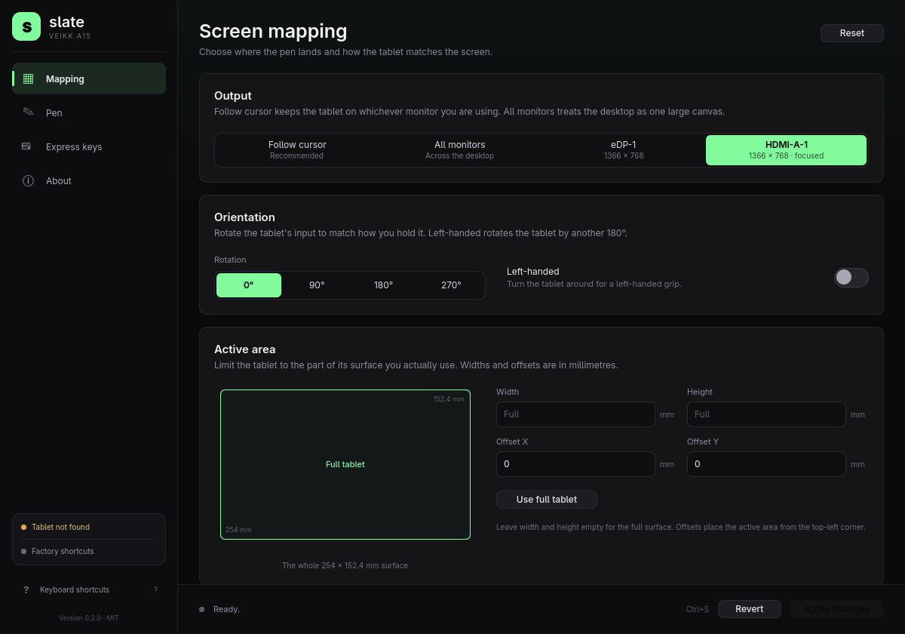
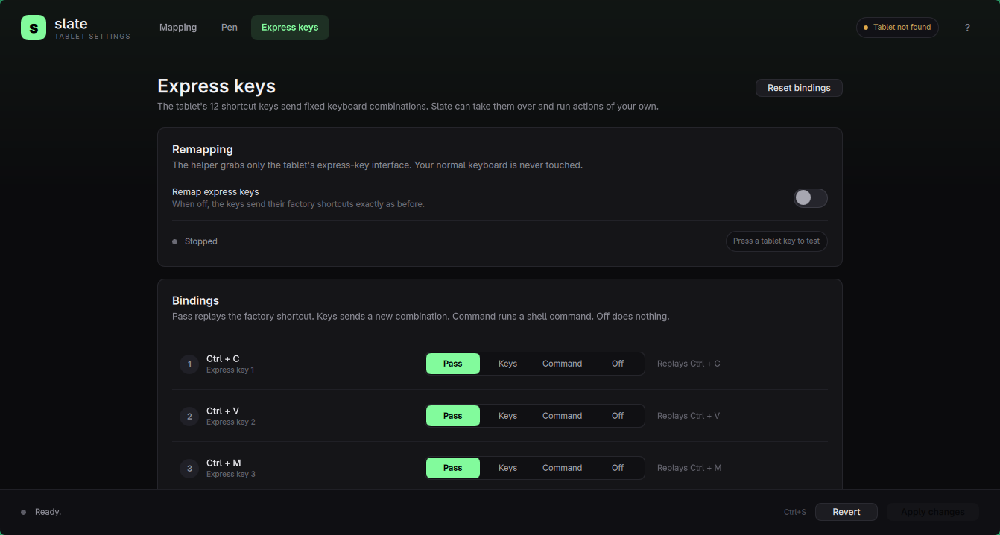

# slate

A small, native settings app for the **VEIKK A15** drawing tablet on
Hyprland. It manages screen mapping, tablet orientation, the active area, pen
pressure, and the tablet's twelve express keys.

Slate is built with Qt 6 and Qt Quick, ships as a single binary, follows the
Omarchy accent colour and rounding, and installs as a normal Arch package.



## Features

- **Screen mapping** — follow the cursor, map to all outputs, or pin the
  tablet to a specific monitor. Rotation in 90° steps and left-handed mode.
- **Active area** — crop the physical tablet surface and preview it to scale.
- **Region mapping** — limit the mapped part of the desktop, with an optional
  absolute position.
- **Pen pressure** — use the native range or set a custom minimum and maximum.
- **Live pen test** — a pad that shows position, pressure, tilt, and proximity
  straight from evdev, even while the app is unfocused.
- **Express keys** — take over the A15's twelve factory shortcuts and make each
  one pass through, send a different shortcut, run a command, or do nothing.
- **Live key detection** — press a tablet key to see which binding it matches.
- **Native persistence** — tablet settings are written to a clearly marked
  block in `~/.config/hypr/input.lua` and applied with `hyprctl reload`.
  Invalid configs are rolled back automatically.
- **Theme and language aware** — reads the accent colour and corner radius from
  Omarchy and follows the desktop language.

## Requirements

- Arch Linux or an Arch derivative
- Hyprland 0.56 or newer with the Lua configuration layout used by
  Omarchy 4.5 (`~/.config/hypr/input.lua`)
- Qt 6: `qt6-base`, `qt6-declarative`, `qt6-wayland`
- `wtype` for replaying express-key shortcuts
- A connected VEIKK A15 (`2feb:0004`)

`hyprland` and `wtype` are runtime dependencies for the full experience. The
app still opens without the tablet connected, but mapping and the live pen test
need it.

## Install

Clone the repository and run the installer:

```sh
git clone https://github.com/PhaNtoM-GHosT-11101/slate.git
cd slate
./bin/install
```

`bin/install` builds the app, creates a source tarball, and runs
`makepkg -fsi`. The package installs:

| Path | Purpose |
| --- | --- |
| `/usr/bin/slate` | the app and express-key helper |
| `/usr/share/applications/slate.desktop` | launcher entry |
| `/usr/share/icons/hicolor/scalable/apps/slate.svg` | app icon |
| `/usr/lib/systemd/user/slate.service` | express-key helper unit |
| `/usr/lib/udev/rules.d/70-slate-veikk-a15.rules` | user access to the tablet |
| `/usr/lib/udev/hwdb.d/61-veikk-a15.hwdb` | libinput axis resolution |

After installing, unplug and replug the tablet (or run
`sudo udevadm trigger --subsystem-match=input`) so udev applies the new rule.
The udev rule grants the logged-in desktop user access through a `uaccess` ACL;
you do **not** need to join the `input` group.

Run the app from the launcher or with:

```sh
slate
```

### Enable express-key remapping

Installing the package only provides the helper. Turn on **Express keys →
Remap express keys** in the app, or enable the user service directly:

```sh
systemctl --user enable --now slate.service
```

The helper starts automatically with the graphical session after that. Turn
the toggle off to stop it and restore the factory shortcuts.

## Using Slate

### Mapping

- **Output** — *Follow cursor* keeps the tablet on the monitor under the
  pointer; *All monitors* treats the desktop as one canvas; a monitor name
  pins it.
- **Orientation** — rotate in 90° steps. *Left-handed* adds 180°.
- **Active area** — width and height crop the physical surface. Leave them
  empty for the full 254 × 152.4 mm area. Offsets start at the top-left.
- **Region** — maps only part of the desktop. It is available when the whole
  desktop is the output; absolute positioning places the region in desktop
  coordinates.
- **Reset** returns the page to defaults; **Apply changes** persists and
  reloads Hyprland; **Revert** discards unsaved edits.

### Pen

Turn on **Custom pressure range** and drag the sliders to change which raw
pressure values count as the lightest and heaviest strokes. The live pad below
shows `X`, `Y`, pressure, tilt, and whether the pen is in range. It reads
`/dev/input/event*` directly, so it works without focusing the window.

### Express keys



Each row can be set to:

| Action | Behaviour |
| --- | --- |
| **Pass** | Replays the factory shortcut (default) |
| **Keys** | Sends a combination you type, such as `ctrl+shift+t` |
| **Command** | Runs a shell command with `/bin/sh -c` |
| **Off** | Swallows the key press |

Bindings are saved to `~/.config/slate/keys.json` and reloaded on every press,
so edits take effect immediately. The helper grabs only the tablet's
`VEIKK.INC A15 Keyboard` interface; your normal keyboard is untouched. While
the helper is stopped, the tablet's firmware shortcuts work as usual.

The twelve factory shortcuts, in key order, are:

| # | Shortcut | # | Shortcut |
| --- | --- | --- | --- |
| 1 | `Ctrl + C` | 7 | `W` |
| 2 | `Ctrl + V` | 8 | `E` |
| 3 | `Ctrl + M` | 9 | `Page Up` |
| 4 | `Ctrl + L` | 10 | `Page Down` |
| 5 | `B` | 11 | `Ctrl + P` |
| 6 | `F5` | 12 | `Ctrl + E` |

## Configuration and state

| Path | Contents |
| --- | --- |
| `~/.config/hypr/input.lua` | Managed `slate: tablet settings` block |
| `~/.config/slate/keys.json` | Express-key bindings |
| `~/.local/state/slate/status.json` | Last key press, used by the app |

The block in `input.lua` looks like this and is replaced as a unit. Do not edit
inside the markers; use the app instead.

```lua
-- >>> slate: tablet settings >>>
-- Managed by slate. Edit tablet settings in the app; changes here are overwritten.
hl.config({
  input = {
    tablet = {
      output = "current",
      transform = 0,
      left_handed = false,
      active_area_size = { 0, 0 },
      active_area_position = { 0, 0 },
      region_size = { 0, 0 },
      region_position = { 0, 0 },
      absolute_region_position = false,
    },
    tablettool = {
      pressure_range_min = -1,
      pressure_range_max = -1,
    },
  },
})
-- <<< slate: tablet settings <<<
```

When applying, Slate snapshots `hyprctl configerrors` first, reloads Hyprland,
and compares the result. If the reload fails or introduces a new config error,
the previous file contents are restored and reloaded.

## How it works

- **Settings** — Slate edits Hyprland's live `input:tablet` and
  `input:tablettool` options through the managed Lua block. `Hyprland` reads
  the block at startup, so settings survive reboots.
- **Device access** — the A15 exposes a pen interface and a keyboard interface.
  A udev `uaccess` rule lets the desktop user open both. The hwdb entry supplies
  the axis resolution that libinput otherwise reports as missing, which is why
  the tablet is not usable out of the box.
- **Pen test** — `PenMonitor` reads the pen event node directly and publishes
  position, pressure, tilt, and proximity to QML. It never grabs the device.
- **Express keys** — `slate --daemon` finds the keyboard event node by name,
  takes an exclusive `EVIOCGRAB`, tracks modifier state, and runs the binding
  for each completed combination. It writes the last press to the status file
  so the GUI can highlight it. On exit or disconnect the grab is released.
- **Replay** — *Pass* and *Keys* use `wtype`, which synthesises the shortcut on
  the active Wayland session. The helper finds the Wayland socket under
  `$XDG_RUNTIME_DIR` when the user service does not inherit
  `WAYLAND_DISPLAY`.

## Keyboard shortcuts

| Shortcut | Action |
| --- | --- |
| `Ctrl + 1` / `2` / `3` | Switch page |
| `Ctrl + S` | Apply changes |
| `Ctrl + Q` | Quit |
| `?` | Show help |
| `Esc` | Close help |

## Troubleshooting

**The tablet is not detected.** Check `lsusb | grep -i veikk` and
`hyprctl devices`. Unplug and replug the tablet after installation. Slate finds
event nodes by name, so event numbers can change freely.

**"Permission denied" in the live pen test.** The udev rule is not active for
your session. Replug the tablet, run
`sudo udevadm trigger --subsystem-match=input`, then check
`getfacl /dev/input/event*`. If you installed before logging in, log out and
back in. Do not add yourself to `input` unless you understand the security
implications.

**Hyprland rejects the tablet as "missing x/y resolution".** The hwdb entry is
not loaded. Reinstall the package, run `sudo systemd-hwdb update`, and replug
the tablet.

**Express keys still send their factory shortcuts.** The helper is not
running or cannot grab the device. Check:

```sh
systemctl --user status slate.service
journalctl --user -u slate.service -n 50
```

The toggle in the app must be on for remapping. Turning it off intentionally
restores the firmware shortcuts.

**A remapped key does nothing.** Confirm the binding exists in
`~/.config/slate/keys.json` and that the service is running. For *Command*,
run the command in a terminal first. For *Keys*, use the app's key syntax
(`ctrl+shift+t`, `f5`, `pageup`). The helper logs failures to the user journal.

**Hyprland reports a config error after applying.** Slate restores the previous
file when a new error appears. Check `hyprctl configerrors` and make sure the
managed block is not duplicated or edited by hand. Remove the block between the
`slate: tablet settings` markers if you want to manage those options yourself.

**The window opens on the other monitor.** This is a normal tiling-compositor
behaviour: use your Hyprland window rules or move the window once; Slate does
not force its own placement.

## Development

Build the app:

```sh
./bin/build
./bin/run
```

Run the test suite (Qt Test, no tablet required):

```sh
./bin/test
```

Build and install the package:

```sh
./bin/install
```

The source layout:

```
src/            C++ backend, daemon, evdev readers, and QML UI
src/pages/      Mapping, Pen, and Express keys pages
src/components/ shared QML controls
tests/          parser, settings, bindings, and theme tests
pkgbuild/       PKGBUILD, desktop entry, icon, service, udev, and hwdb files
```

## Uninstall

```sh
systemctl --user disable --now slate.service
sudo pacman -Rns slate
```

Then optionally remove `~/.config/slate/` and
`~/.local/state/slate/`, and delete the block between the
`slate: tablet settings` markers in `~/.config/hypr/input.lua`.

## License

MIT. See [LICENSE](LICENSE).
