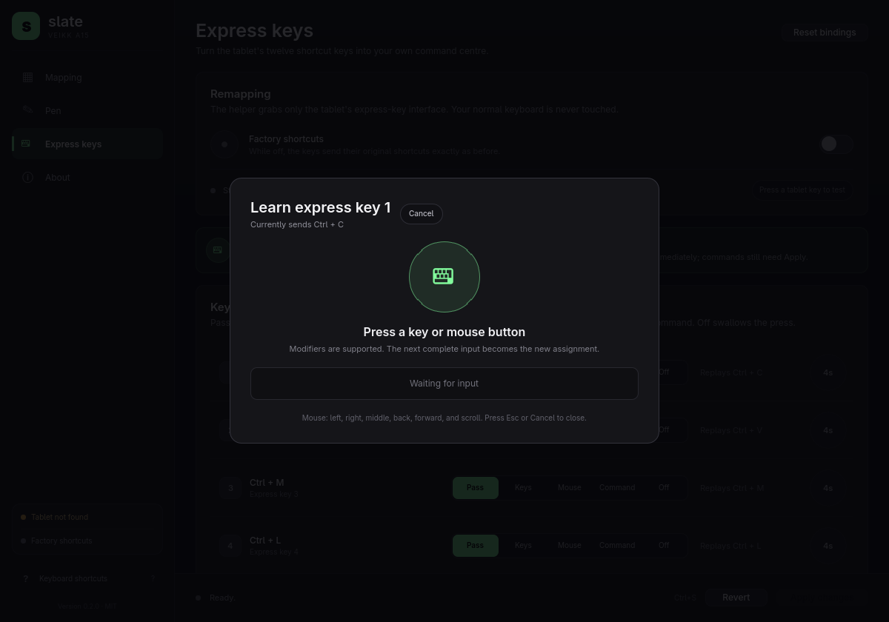
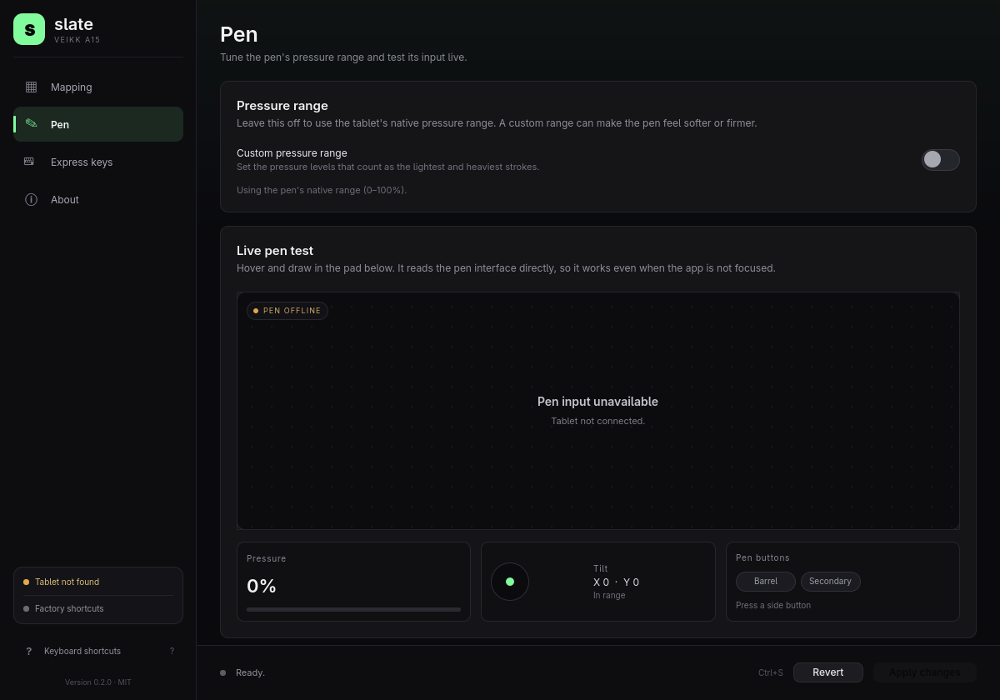
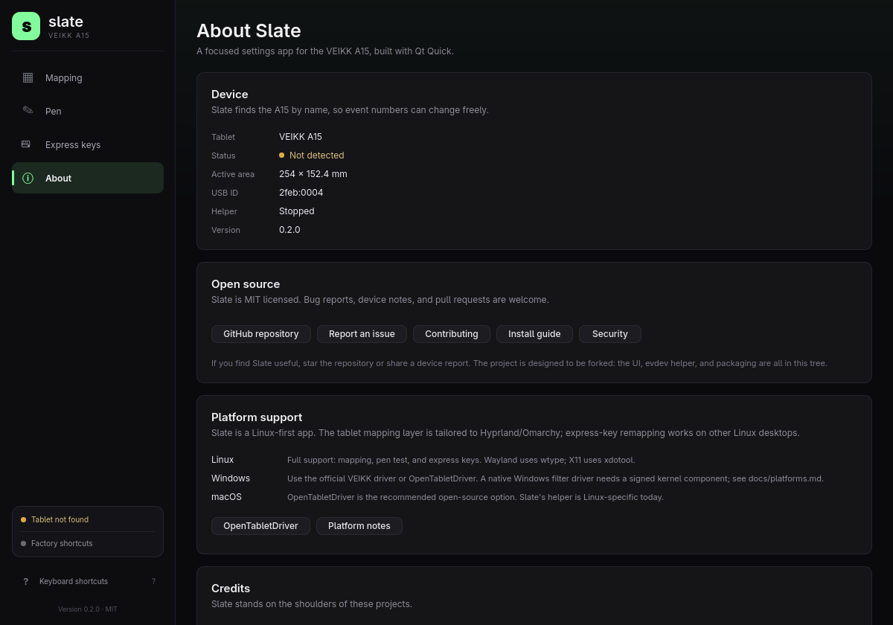

# Slate


A native settings app and express-key helper for the **VEIKK A15** drawing
tablet. Slate handles screen mapping, pen pressure, live pen testing, and all
twelve tablet shortcut keys from one small Qt 6 app.

Slate is Linux-first, but it is built to be easy to package, easy to fork, and
honest about the platform boundary: Hyprland gets the complete experience,
other Linux desktops get pen testing and express-key remapping, and Windows
and macOS users are pointed at OpenTabletDriver or the official VEIKK driver.


## Highlights

- **Four-second learn gesture** — hold the circular learn button beside a key
  for four seconds, then press any keyboard shortcut or mouse button. The
  complete press becomes the new assignment.
- **Mouse actions** — bind an express key to left, right, or middle click,
  back/forward, or four-way scroll.
- **Twelve express keys** — pass through, send a different shortcut, click or
  scroll, run a command, or swallow the key entirely.
- **Screen mapping** — follow the cursor, span every output, or pin the tablet
  to one monitor, with rotation, left-handed mode, active-area cropping, and
  region mapping.
- **Pen tuning** — native or custom pressure range, plus a live pad showing
  position, pressure, tilt, and proximity straight from evdev.
- **Native persistence** — tablet settings live in a clearly marked block in
  `~/.config/hypr/input.lua`; bindings live in `~/.config/slate/keys.json`.
- **Safe failure** — a rejected Hyprland reload rolls the config back, and
  invalid bindings fall back to pass-through instead of breaking the helper.
- **Theme aware** — follows the Omarchy accent colour and corner rounding.

## Install

### One line (source install)

```sh
curl -fsSL https://raw.githubusercontent.com/PhaNtoM-GHosT-11101/slate/main/install.sh | bash
```

The installer detects Arch, Debian/Ubuntu, Fedora, or openSUSE, installs the
Qt 6 build and runtime packages, builds Slate, installs it under
`/usr/local`, installs the systemd user helper, and adds the udev rules. It
asks before enabling the helper. See
[docs/installation.md](docs/installation.md) for per-user installs, upgrade
steps, and every dependency list.

### From a clone

```sh
git clone https://github.com/PhaNtoM-GHosT-11101/slate.git
cd slate
./install.sh
```

### Arch Linux package

```sh
git clone https://github.com/PhaNtoM-GHosT-11101/slate.git
cd slate
./bin/install          # builds and installs the package
./bin/package          # builds the package without installing it
```

The generated package is
`pkgbuild/slate-0.2.0-1-x86_64.pkg.tar.zst`. To install a package you built
separately:

```sh
sudo pacman -U pkgbuild/slate-0.2.0-1-x86_64.pkg.tar.zst
```

### After installing

1. Reconnect the tablet so udev applies the access rules.
2. Start **Slate** from the app launcher or run `slate`.
3. Open **Express keys** and turn on **Remap express keys** to start the helper.

The helper is a systemd user service. You can also manage it directly:

```sh
systemctl --user enable --now slate.service
systemctl --user status slate.service
```

## Hold to learn

1. Open **Express keys**.
2. Hold the circular **4s** button on a key row for four seconds. The ring
   fills while you hold.
3. When the capture sheet opens, press a key on your regular keyboard or click
   a mouse button. Modifier combinations such as `Ctrl + Shift + T` are
   supported; scroll up/down/left/right is supported too.
4. The assignment is saved immediately. Press **Esc** or **Cancel** to close
   the sheet without changing anything.

The capture sheet reads the next complete key or mouse press. A modifier by
itself is not a complete assignment, so the sheet keeps waiting. The tablet's
own express-key interface is grabbed by the helper while remapping is on, so
use your regular keyboard for capture.



## Express-key actions

Each of the twelve rows can use one of these actions:

| Action | Behaviour |
| --- | --- |
| **Pass** | Replays the factory shortcut (default) |
| **Keys** | Sends a keyboard shortcut you capture or type, such as `ctrl+shift+t` |
| **Mouse** | Clicks or scrolls: left, right, middle, back, forward, wheel up/down/left/right |
| **Command** | Runs a shell command with `/bin/sh -c` |
| **Off** | Swallows the press |

Bindings are stored in `~/.config/slate/keys.json` and reloaded by the helper
on every change, so edits take effect immediately. The helper grabs only the
tablet's `VEIKK.INC A15 Keyboard` interface; your normal keyboard is never
touched. While the helper is stopped, the tablet's firmware shortcuts work as
usual.

Select **Mouse** on a row and click the value field to pick a click or scroll
direction directly. Holding the **4s** button and clicking also captures a
mouse action, including back and forward buttons.

The twelve factory shortcuts, in key order, are:

| # | Shortcut | # | Shortcut |
| --- | --- | --- | --- |
| 1 | `Ctrl + C` | 7 | `W` |
| 2 | `Ctrl + V` | 8 | `E` |
| 3 | `Ctrl + M` | 9 | `Page Up` |
| 4 | `Ctrl + L` | 10 | `Page Down` |
| 5 | `B` | 11 | `Ctrl + P` |
| 6 | `F5` | 12 | `Ctrl + E` |

### Mouse permissions

Mouse actions create a small virtual mouse with `/dev/uinput`. The package
installs a `uaccess` rule for `/dev/uinput`; the desktop user gets access
without joining the `input` group. This is the same mechanism used by Steam
Input and other user-session input tools, and it intentionally lets a desktop
application inject pointer events. If you do not want that, leave mouse
actions unused and do not install the uinput rule. See
[SECURITY.md](SECURITY.md) for the full trust model, including command actions
and input-device permissions.

## Requirements

- Linux with a 2.6+ kernel evdev interface
- Qt 6: `qt6-base`, `qt6-declarative`, `qt6-wayland`
- A C++17 compiler, `make`, and `qmake6` for source builds
- `wtype` for shortcut replay on Wayland
- `xdotool` for shortcut replay on X11
- Hyprland 0.56 or newer with the Lua configuration layout used by
  Omarchy 4.5 (`~/.config/hypr/input.lua`) for screen mapping
- A connected VEIKK A15 (`2feb:0004`)

The app opens without the tablet connected. Mapping and the live pen test need
the tablet; express-key editing works offline and is picked up when the helper
starts. See [docs/installation.md](docs/installation.md) for the package list
on each distribution and [docs/platforms.md](docs/platforms.md) for the full
support matrix.

## Platform support

| Platform | Screen mapping | Pen test | Express keys | Notes |
| --- | --- | --- | --- | --- |
| Hyprland (Omarchy) | Yes | Yes | Yes | Complete experience |
| Other Linux Wayland desktops | Hyprland-specific | Yes | Yes | `wtype` for shortcut replay |
| Linux X11 desktops | Hyprland-specific | Yes | Yes | `xdotool` for shortcut replay |
| Windows | No | No | Use OpenTabletDriver | No Windows kernel driver is shipped by Slate |
| macOS | No | No | Use OpenTabletDriver | Community tablet support |

Slate does not pretend to be a signed Windows kernel driver. A real Windows
filter driver needs a signed kernel component and a Windows build/test
pipeline; that is outside this project. For Windows and macOS, use
[OpenTabletDriver](https://opentabletdriver.net/) (it lists the A15 and A15
V2, including express-key bindings) or VEIKK's official driver. See
[docs/platforms.md](docs/platforms.md) for the full matrix, install commands
for each distribution, and a Windows setup guide.

## Using Slate

### Mapping

- **Output** — *Follow cursor* keeps the tablet on the monitor under the
  pointer; *All monitors* treats the desktop as one canvas; a monitor name
  pins it.
- **Orientation** — rotate in 90° steps. *Left-handed* adds 180°.
- **Active area** — width and height crop the physical surface. Leave them
  empty for the full 254 × 152.4 mm area. Offsets start at the top-left.
- **Region** — maps only part of the desktop. It is available when the whole
  desktop is the output; absolute positioning places the region in desktop
  coordinates.
- **Reset** returns the page to defaults; **Apply changes** persists and
  reloads Hyprland; **Revert** discards unsaved edits.

### Pen

Turn on **Custom pressure range** and drag the sliders to choose the lightest
and heaviest points of the pen's pressure curve, from 0% to 100%. The live pad
below shows `X`, `Y`, pressure, tilt, and whether the pen is in range. It reads
`/dev/input/event*` directly, so it works without focusing the window.



### Express keys


The status card shows whether the helper is running, what it last saw, and the
current service state. The **Learn by doing** banner explains the hold
gesture. Each row has the factory shortcut, an action segmented control, the
current value, and the circular hold-to-learn button.

Commands are the one action that still uses **Apply changes**; key and mouse
assignments save as soon as they are captured.

### About

The About page shows the app and Qt versions, the detected tablet, helper
status, and links to the installation guide, contribution notes, security
policy, and repository.



## Configuration and state

| Path | Contents |
| --- | --- |
| `~/.config/hypr/input.lua` | Managed `slate: tablet settings` block |
| `~/.config/slate/keys.json` | Express-key bindings |
| `~/.local/state/slate/status.json` | Last key press, used by the app |

The block in `input.lua` looks like this and is replaced as a unit. Do not edit
inside the markers; use the app instead.

```lua
-- >>> slate: tablet settings >>>
-- Managed by slate. Edit tablet settings in the app; changes here are overwritten.
hl.config({
  input = {
    tablet = {
      output = "current",
      transform = 0,
      left_handed = false,
      active_area_size = { 0, 0 },
      active_area_position = { 0, 0 },
      region_size = { 0, 0 },
      region_position = { 0, 0 },
      absolute_region_position = false,
    },
    tablettool = {
      pressure_range_min = -1,
      pressure_range_max = -1,
    },
  },
})
-- <<< slate: tablet settings <<<
```

When applying, Slate snapshots `hyprctl configerrors` first, reloads Hyprland,
and compares the result. If the reload fails or introduces a new config error,
the previous file contents are restored and reloaded.

## How it works

- **Settings** — Slate edits Hyprland's live `input:tablet` and
  `input:tablettool` options through the managed Lua block. Hyprland reads the
  block at startup, so settings survive reboots.
- **Device access** — the A15 exposes a pen interface and a keyboard interface.
  A udev `uaccess` rule lets the desktop user open both. The hwdb entry supplies
  the axis resolution that libinput otherwise reports as missing, which is why
  the tablet is not usable out of the box.
- **Pen test** — `PenMonitor` reads the pen event node directly and publishes
  position, pressure, tilt, and proximity to QML. It never grabs the device.
- **Express keys** — `slate --daemon` finds the keyboard event node by name,
  takes an exclusive `EVIOCGRAB`, tracks modifier state, and runs the binding
  for each completed combination. It writes the last press to the status file
  so the GUI can highlight it. On exit or disconnect the grab is released.
- **Replay** — *Pass* and *Keys* use `wtype` on Wayland and `xdotool` on X11.
  The helper finds the Wayland socket under `$XDG_RUNTIME_DIR` when the user
  service does not inherit `WAYLAND_DISPLAY`.
- **Mouse** — mouse actions open a virtual uinput mouse named
  `Slate Virtual Mouse`; each trigger emits a press/release pair or one scroll
  step. The device is destroyed when the helper exits.

## Keyboard shortcuts

| Shortcut | Action |
| --- | --- |
| `Ctrl + 1` / `2` / `3` / `4` | Switch page |
| `Ctrl + S` | Apply changes |
| `Ctrl + Q` | Quit |
| `?` | Show help |
| `Esc` | Close help or cancel capture |

Global shortcuts are disabled while the capture sheet is open, so a captured
`Ctrl + S` or `?` is not stolen by the app.

## Troubleshooting

**The tablet is not detected.** Check `lsusb | grep -i veikk` and
`hyprctl devices`. Unplug and replug the tablet after installation. Slate
finds event nodes by name, with a fallback that accepts A15 variants.

**"Permission denied" in the live pen test.** The udev rule is not active for
your session. Replug the tablet, run
`sudo udevadm trigger --subsystem-match=input`, then check
`getfacl /dev/input/event*`. If you installed before logging in, log out and
back in. Do not add yourself to `input` unless you understand the security
implications.

**Hyprland rejects the tablet as "missing x/y resolution".** The hwdb entry is
not loaded. Reinstall the package, run `sudo systemd-hwdb update`, and replug
the tablet.

**Express keys still send their factory shortcuts.** The helper is not running
or cannot grab the device. Check:

```sh
systemctl --user status slate.service
journalctl --user -u slate.service -n 50
```

The toggle in the app must be on for remapping. Turning it off intentionally
restores the firmware shortcuts.

**A mouse action does nothing.** Check that `/dev/uinput` exists and is
accessible:

```sh
ls -l /dev/uinput
getfacl /dev/uinput
systemctl --user restart slate.service
journalctl --user -u slate.service -n 30
```

Reconnect or log out/in after installing so the uaccess ACL is applied. Mouse
actions are logged with a clear error when the virtual device cannot be
created.

**A remapped key does nothing.** Confirm the binding exists in
`~/.config/slate/keys.json` and that the service is running. For *Command*,
run the command in a terminal first. For *Keys*, use the app's key syntax
(`ctrl+shift+t`, `f5`, `pageup`). The helper logs failures to the user journal.

**Shortcut replay does not work.** On Wayland, `wtype` must be installed and
the compositor must support the virtual-keyboard protocol. On X11, install
`xdotool`. Slate chooses based on the session; you can force a choice with
`SLATE_REPLAY=wtype` or `SLATE_REPLAY=xdotool` in the service environment.

**The capture sheet does not see the key I pressed.** Make sure the Slate
window has focus. The tablet's own express-key interface is grabbed by the
helper, so capture listens to your regular keyboard and mouse. Press a complete
key or mouse button; modifiers alone are ignored.

**The hold gesture does nothing.** Hold for the full four seconds; a quick
click is intentionally ignored. Keep the pointer still while the ring fills.
The learn button is keyboard-accessible too, but the deliberate hold is what
prevents accidental rebinds. If the ring never fills, check that the window is
responsive and that no other window has taken focus.

**A command action does nothing.** Commands are the one action that still uses
**Apply changes**. Run the command in a terminal first; the helper executes it
with `/bin/sh -c` as your user and reports failures in the user journal.

**Hyprland reports a config error after applying.** Slate restores the previous
file when a new error appears. Check `hyprctl configerrors` and make sure the
managed block is not duplicated or edited by hand. Remove the block between the
`slate: tablet settings` markers if you want to manage those options yourself.

**The window opens on the other monitor.** This is normal tiling-compositor
behaviour: use your Hyprland window rules or move the window once; Slate does
not force its own placement.

## Development

Build the app:

```sh
./bin/build
./bin/run
```

Run the test suite (Qt Test, no tablet required):

```sh
./bin/test
```

Render documentation screenshots without a compositor. Use temporary config
and state directories so your personal bindings and tablet state do not end up
in the images:

```sh
tmp="$(mktemp -d)"
export XDG_CONFIG_HOME="$tmp/config" XDG_STATE_HOME="$tmp/state"
export QT_QPA_PLATFORM=offscreen
mkdir -p "$XDG_CONFIG_HOME" "$XDG_STATE_HOME"

./build/slate --page 0 --screenshot docs/slate-mapping.png
./build/slate --page 1 --screenshot docs/slate-pen.png
./build/slate --page 2 --screenshot docs/slate-keys.png
./build/slate --page 3 --screenshot docs/slate-about.png
./build/slate --page 2 --capture --screenshot docs/slate-learn.png

rm -rf "$tmp"
```

Build the Arch package without installing it:

```sh
./bin/package
```

To build and install in one step, use `./bin/install`.

The source layout:

```
src/            C++ backend, daemon, evdev readers, and QML UI
src/pages/      Mapping, Pen, Express keys, and About pages
src/components/ shared QML controls
tests/          parser, settings, bindings, capture, and theme tests
pkgbuild/       PKGBUILD, desktop entry, icon, service, udev, and hwdb files
docs/           screenshots, platform notes, and GitHub metadata
```

See [CONTRIBUTING.md](CONTRIBUTING.md) for the development workflow,
[docs/installation.md](docs/installation.md) for installation and upgrades,
[docs/platforms.md](docs/platforms.md) for distribution and Windows details,
and [SECURITY.md](SECURITY.md) for the input and permission model.

## Uninstall

For a source install:

```sh
./uninstall.sh
```

For a per-user install:

```sh
./uninstall.sh --prefix "$HOME/.local"
```

For the Arch package:

```sh
systemctl --user disable --now slate.service
sudo pacman -Rns slate
```

Then optionally remove `~/.config/slate/` and `~/.local/state/slate/`, and
delete the block between the `slate: tablet settings` markers in
`~/.config/hypr/input.lua`.

## License

MIT. See [LICENSE](LICENSE).
